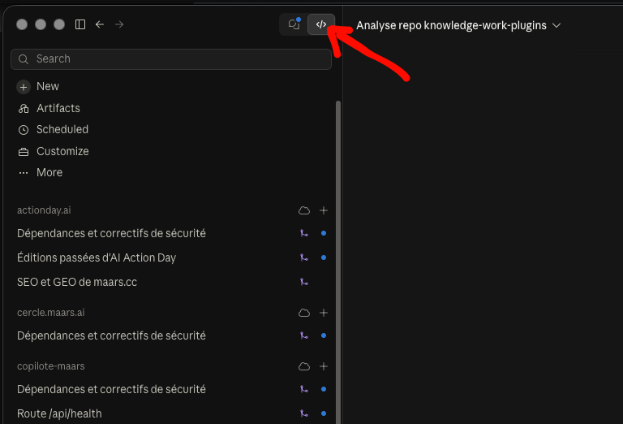

# Installer le plugin Recrutement sur votre Mac

Durée : 20 minutes, dont 10 de téléchargement. Vous n'avez rien à taper dans un terminal : Claude s'en charge. Il vous demandera deux choses en cours de route : votre mot de passe de session (une fois) et des clics dans des fenêtres Google.

---

## 1. Ouvrir Claude Code

Claude Code est intégré à l'application Claude sur Mac. Dans la barre du haut, cliquer sur l'icône `</>` :



Puis :

1. Cliquer sur **New**.
2. Choisir un **dossier** de travail : créer un dossier vide, par exemple `Documents/maars-recrutement`, et le sélectionner.
3. Choisir le **modèle** : prendre le plus récent proposé (Opus ou Fable).

## 2. Coller le prompt d'installation

Copier tout le bloc ci-dessous et le coller dans la conversation, puis Entrée.

```
Je suis le recruteur. Installe le plugin Recrutement sur ce Mac et vérifie qu'il fonctionne. Je ne suis pas développeur : explique chaque étape en une phrase avant de la faire, et dis-moi exactement quand tu as besoin de moi (mot de passe, clic dans une fenêtre).

Étapes :
1. Télécharge le plugin depuis https://github.com/iamthemediagit/knowledge-work-plugins (dossier recrutement/) dans ce dossier de travail. Lis recrutement/TOOLS.md.
2. Lance recrutement/scripts/setup.sh. Il installe Homebrew (il demandera mon mot de passe de session : préviens-moi), ffmpeg, whisper.cpp, le modèle de langue (3 Go) et la commande "transcrire". Si une étape échoue, lis l'erreur, corrige, relance : le script peut être relancé sans risque.
3. Vérifie : ffmpeg, whisper-cli et transcrire doivent répondre. Montre-moi le résultat.
4. Installe le plugin dans Claude : marketplace iamthemediagit/knowledge-work-plugins, plugin recrutement.
5. Explique-moi en 3 lignes comment connecter Gmail, Google Drive et Google Calendar dans Claude (Cowork), avec le compte Google de l'entreprise qui a accès au tableur de recrutement et au dossier Drive des vidéos.
6. Pour finir, propose-moi de tester sur 2 vidéos : je les mets dans un dossier, tu lances "transcrire" dessus, et tu me montres le début d'une transcription.

Règles : n'installe rien d'autre que ce que setup.sh prévoit. N'envoie aucune vidéo ni aucun fichier sur internet. Si quelque chose te semble bloqué par une politique d'entreprise sur ce Mac, arrête et dis-le-moi.
```

## 3. Pendant l'installation

- **Permissions** : Claude demande l'autorisation avant chaque commande. Accepter celles qui viennent du script `setup.sh` et de la vérification.
- **Mot de passe** : Homebrew le demande une fois, dans la fenêtre de Claude Code. Le taper, il ne s'affiche pas, c'est normal.
- **Fenêtres Google** : pour les connecteurs, une page d'autorisation s'ouvre dans le navigateur. Se connecter avec le compte Google de l'entreprise, accepter.

## 4. Ensuite, au quotidien

Tout se passe dans **Cowork** (l'app Claude, mode normal), pas dans Claude Code :

| Vous dites | Ce qui se passe |
|---|---|
| « où on en est ? » | Le tableur est mis à jour depuis Gmail et Drive, les relances à faire sont listées |
| « rédige les relances » | Les emails sont préparés, vous validez la liste des destinataires, puis ils partent |
| « évalue les vidéos reçues » | Les vidéos transcrites sont notées sur la grille, avec les citations ; vous validez chaque note |
| « prépare l'entretien de [prénom] » | Un kit de 2 pages : ce qu'on sait, ce qu'il reste à vérifier, les questions |
| « point recrutement » | Une page : le funnel, ce qui attend votre décision, les 3 actions de la semaine |

Seule exception : **transcrire une nouvelle vague de vidéos** se fait dans Claude Code (ou dans Terminal) avec `transcrire ~/Downloads/videos-candidats`. Claude peut le faire pour vous si vous lui demandez dans Claude Code.

## 5. Si ça bloque

Coller le message d'erreur dans Claude Code et demander. Le tableau de dépannage est dans `TOOLS.md`. Et sinon : Franck.
